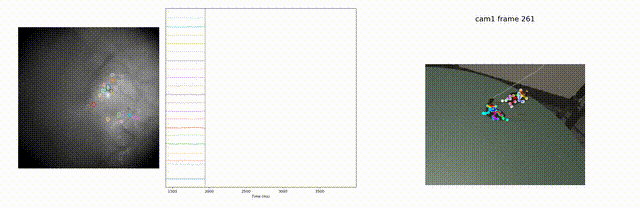
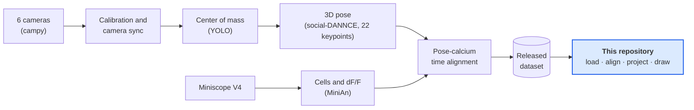

# BBOP

**Bryan Building Open Field Pipeline**: 3D pose of freely interacting mice, recorded
together with calcium imaging.

<p align="center">
  
</p>
<p align="center"><sub>
Left: the miniscope field of view with the detected cells. Middle: their calcium traces.
Right: the 3D pose of both mice drawn on Camera 1. All three panels play on one shared clock.
</sub></p>

Six cameras film mice in a 1 m open field. Social-DANNCE gives each mouse 22 body
keypoints in 3D, and in part of the sessions a UCLA Miniscope V4 records calcium activity
in visual cortex (V1) or motor cortex (M1/PMC).

This repository is the code to **use the released dataset**: load a session, put pose and
calcium on one clock, project 3D points into any camera, and draw the pose on the videos.
It accompanies the BBOP dataset paper.

## How the data were made



## Install

```bash
git clone https://github.com/gadsfly/bbop-release.git
cd bbop-release
conda env create -f environment.yml
conda activate bbop
pip install -e .
```

Tested with Python 3.9 on Linux.

## Quick start

Point `RELEASE_ROOT` at the downloaded dataset. A session is named
`cohort/kind/session`.
`notebooks/load_session.ipynb` runs all of this on one calcium session and one
behavior-only session.

### 1. A session with calcium imaging

Pose and center of mass are interpolated onto the miniscope timestamps. The calcium
and dF/F values are the measured ones and are never interpolated.

```python
import os
from utlis.sync_utlis.loader_interp import merge_all_data_interp

RELEASE_ROOT = "/path/to/release"
rec_path = os.path.join(RELEASE_ROOT, "oct3v1_mini/social/20241031_VC4+UNK1_S1")
merged, beh_df, mini_df, pose_interp, ca, dff, info = merge_all_data_interp(rec_path)
# merged: one row per miniscope frame, with pose, COM, calcium and dF/F columns
```

### 2. A behavior-only session

Use this for `oct3v1_beh_only`, or for any session when you do not need calcium.
You get one row per pose frame, on the Camera 1 clock.

```python
from utlis.sync_utlis.loader_interp import load_behavior_only

rec_path = os.path.join(RELEASE_ROOT, "oct3v1_beh_only/single/20241004_VC11_S1")
beh_df, pose, com = load_behavior_only(rec_path)   # com is None if the session has no COM
```

### 3. Draw the pose on a camera video

```python
from utlis.vis_valid_utlis.sdannce_vis import visualize_clip

visualize_clip(
    base_path=rec_path,
    pred_folder="annotations",
    pred_filename="pose3d_mouse22.mat",
    com_filename="com3d.mat",
    animal="mouse22",
    cammm=1,            # camera 1-6
    start_frame=1000,
    n_frames=100,
)
# writes an .mp4 to <session>/annotations/vis/
```

## Three things to know before you start

> [!IMPORTANT]
> 1. **Social sessions have two mice.** Pose arrays are `(frames, animals, 3, keypoints)`.
>    Axis 1 holds both animals in a social session, so do not squeeze it.
> 2. **Cameras use the MATLAB / Label3D convention, not OpenCV.** `K` is stored transposed,
>    and points are row vectors. Use the functions in `utlis/projection.py` instead of
>    `cv2.projectPoints`.
> 3. **The six cameras are not frame-locked to each other.** Pose row *i* is video frame
>    `sync.data_frame[i] - 1` of each camera, and that offset differs per camera (0–6 frames
>    in the released sessions). `sdannce_vis` applies it for you. If you read pose row *i*
>    as video frame *i*, the skeleton lands on the wrong frame.

<details>
<summary><b>Camera convention in detail</b></summary>

- `K` is stored transposed: `[[fx, 0, 0], [0, fy, 0], [cx, cy, 1]]`.
- Points are row vectors: `pts_2d = pts_3d @ np.concatenate((R, t), axis=0) @ K`.
- `r` from `load_cameras` is a flattened 3×3 rotation matrix, not a Rodrigues
  vector: `R = np.asarray(r).reshape(3, 3)`.

Use `utlis.projection.load_cameras`, `project_to_2d` and `distortPoints`.
The per-camera frame index `sync.data_frame` is stored in `label3d_dannce.mat` and is 1-based.

</details>

<details>
<summary><b>The 22 keypoints</b></summary>

| index | keypoint | index | keypoint | index | keypoint |
|---|---|---|---|---|---|
| 0 | EarL | 8 | ForepawL | 16 | HindpawL |
| 1 | EarR | 9 | WristL | 17 | AnkleL |
| 2 | Snout | 10 | ElbowL | 18 | KneeL |
| 3 | SpineF | 11 | ShoulderL | 19 | HindpawR |
| 4 | SpineM | 12 | ForepawR | 20 | AnkleR |
| 5 | Tail (base) | 13 | WristR | 21 | KneeR |
| 6 | Tail (mid) | 14 | ElbowR | | |
| 7 | Tail (end) | 15 | ShoulderR | | |

Skeleton edges and colors are in `utlis/connectivity.py` (`mouse22`).

</details>

## What one session looks like

```
<cohort>/<single|social>/<session>/
├── label3d_dannce.mat        calibration of the six cameras, and each camera's
│                             synchronized frame index (sync.data_frame)
├── annotations/
│   ├── pose3d_mouse22.mat    3D pose, `pred`: (frames, animals, 3, 22), mm
│   ├── com3d.mat             center of mass, `com`: (frames, 3) or (frames, 3, 2)
│   └── *_provenance.json     how each product was made
├── metadata/
│   └── frame_mapping.json    miniscope-to-camera mapping, including time_offset
├── miniscope/                calcium sessions only
│   ├── miniscope.nc          MiniAn output
│   └── timeStamps.csv
└── videos/Camera1 ... Camera6/
    ├── 0.mp4
    └── frametimes.npy
```

`cohort` is `oct3v1_mini` (with calcium imaging) or `oct3v1_beh_only`.

## What is in the code

| module | what it does |
|---|---|
| `utlis/sync_utlis/loader_interp.py` | `merge_all_data_interp` (pose and COM onto the miniscope clock) and `load_behavior_only` |
| `utlis/sync_utlis/loader_new_struct.py` | readers for pose, COM, MiniAn signals and `frame_mapping.json` |
| `utlis/sync_utlis/mini_dannce_sync.py` | miniscope-to-camera alignment and `frame_mapping.json` generation |
| `utlis/sync_utlis/sync_df_utlis.py` | camera synchronization from brightness changes; `find_calib_file` |
| `utlis/sync_utlis/dropf_handler.py` | dropped-frame handling on a common camera timeline |
| `utlis/convert_calib_utlis/` | calibration and sync conversion into `label3d_dannce.mat`, intrinsics update, and the calibration wrapper |
| `utlis/exe_engine_utlis/dead_cam_rescue.py` | rescue of sessions with a missing camera |
| `utlis/projection.py` | camera loading and projection (MATLAB convention) |
| `utlis/connectivity.py` | skeleton edges and colors |
| `utlis/vis_valid_utlis/sdannce_vis.py` | pose and COM overlays on the camera videos |

## Related tools

- **3D pose:** social-DANNCE (<https://github.com/tqxli/sdannce>) and DANNCE
  (<https://github.com/spoonsso/dannce>).
- **Center of mass:** YOLO detectors with multi-view triangulation, described in the
  paper's Methods.
- **Calcium extraction:** MiniAn (<https://github.com/denisecailab/minian>).
- **Recording:** campy (<https://github.com/ksseverson57/campy>), with the revisions in
  <https://github.com/data-hound/campy>.
- **Calibration:** newsdannce (<https://github.com/tdunnlab/newsdannce>), run through
  `utlis/convert_calib_utlis/chris_wrapper.py`.
- **Identity-switch correction** for social sessions:
  <https://github.com/gadsfly/reid-switch-corrector>.
- **Cross-session ROI candidates:** <https://github.com/gadsfly/roi-session-alignment>.
- **Recording protocol** (cameras, calibration and the light flash used for sync):
  [PDF](https://drive.google.com/file/d/1_cB2Yxkpt41zbyjxM-VQth-bNA1zPu_v/view?usp=sharing).

## Acknowledgments

BBOP was developed by **Lingxuan (Mir) Qi** in the lab of **Dr. Timothy W. Dunn**, who
funded and directed the project.

- **Tianqing Li** developed social-DANNCE (<https://github.com/tqxli/sdannce>).
- **Dr. Renzhi Zhan** and **Lingxuan (Mir) Qi** did the surgical and recording work behind
  the data.
- **Chris Axon** wrote the newsdannce calibration code that the calibration wrapper runs.
- **Anshuman Sabath** revised campy for these recordings and helped with the arena design,
  debugging and technical advice.
- Advice on the code, its presentation and the data organization came from Anshuman Sabath,
  Tianqing Li and Dr. Timothy W. Dunn.
- The design was inspired by Jim Roach's STUDIO pipeline.
- `project_to_2d` and `distortPoints` in `utlis/projection.py` follow DANNCE (MIT license).

## Citation and license

If you use this code or the dataset, please cite the BBOP dataset paper.

MIT; see `LICENSE`.
